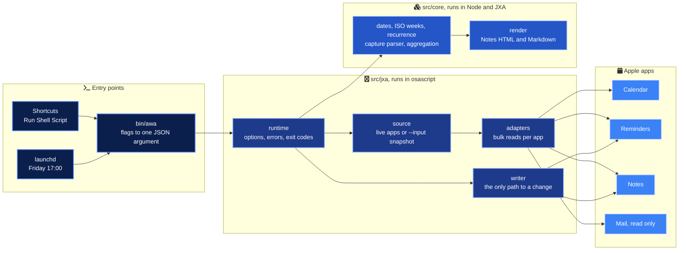
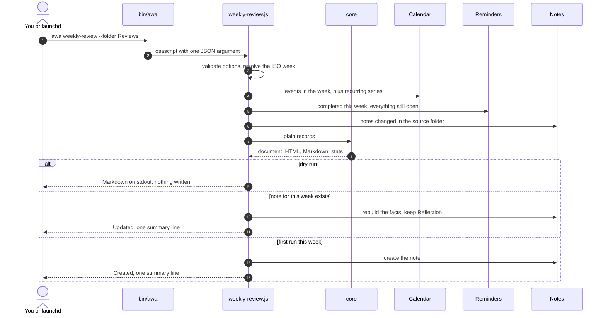
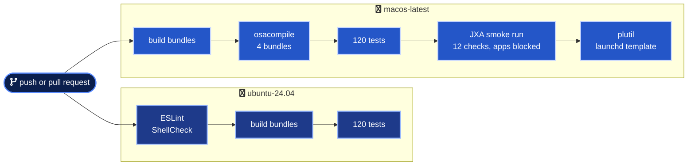

<div align="center">


<h3>Your week in Calendar, Reminders and Notes, reviewed and prepared by scripts you can read, test and schedule.</h3>


</div>

---

## In numbers

| | |
| --- | --- |
| 4 | Commands, from one weekly review note to a CSV of where the time went |
| 4 | Apple apps, with Mail strictly read only and Calendar never written |
| 120 | Unit, snapshot and CLI tests on Node, none of them needing a Mac |
| 12 | Smoke checks that run the real bundles under `osascript` with app access blocked |
| 6 | Snapshot files, matched byte for byte by Node and by JavaScriptCore |
| 4 | Bundles compiled with `osacompile` on every push |
| 1,434 | Lines of logic in `src/core`, all of it testable without any app |
| 568 | Lines in `src/jxa`, the thin layer that talks to the apps |
| 1 | Place in the code that calls `Application()` |
| 0 | Network requests and runtime dependencies |

## What it is

awa is a small command-line toolkit for people who live in Calendar, Reminders and Notes and want the routine parts of the week done for them. It writes a weekly review note every Friday, prepares a note for each meeting coming up, turns a quick-capture note into dated reminders, and tells you where your scheduled time went.

It is plain JavaScript for Automation, so there is nothing to install on the Mac beyond the scripts themselves, and it runs equally well from Terminal, a Shortcut or a launchd schedule. Everything stays on your Mac.

The part that makes it trustworthy is the split. All the decisions (ISO weeks, recurring events, capture syntax, totals, rendering) live in a pure core that is tested on Node. The scripts that touch the apps are a thin shell around it.

## Architecture



| Layer | Holds | Proven by |
| --- | --- | --- |
| `src/core` | Every decision, as plain ES modules with no Apple or Node globals (ESLint enforces it) | 120 tests on Linux and macOS |
| `src/jxa/commands` | Four commands that wire a source, the core and a writer | The smoke run under `osascript` |
| `src/jxa/lib` | Adapters that read in bulk, and the single `writer()` | Review, and a real Mac |
| `scripts/build.mjs` | A 123-line bundler, since JXA has no module loader | A determinism test and `osacompile` |

## How a weekly review comes together



## The four commands

| Command | Reads | Writes | Safe to re-run because |
| --- | --- | --- | --- |
| `weekly-review` | Calendar, Reminders, Notes, flagged Mail headers (opt in) | One note per ISO week, such as `Weekly review 2026-W43` | The note is found by title and refreshed, and your Reflection is kept |
| `meeting-prep` | Calendar, with attendees | One note per meeting, such as `Prep 2026-10-23 17:00 Customer demo` | An existing prep note is never touched |
| `inbox-to-reminders` | One capture note, open reminders | Reminders, and with `--clear` the capture note | An open reminder with the same title is never created twice |
| `focus-report` | Calendar | Markdown, CSV or JSON to stdout or a file | It only reads |

Capture lines read like you would type them. `Call the bank tomorrow 9am #errands !!` becomes a medium-priority reminder in Errands due tomorrow at 09:00. The full syntax and every option are in the [command reference](docs/commands.md).

## Sample output

<details>
<summary>Sample weekly review, rendered from the synthetic fixture week (tests/fixtures/week-2026-w43.json)</summary>

This is the Markdown that `--dry-run` prints. The note in Notes gets the same content as HTML. Every name in the fixture is invented.

```markdown
# Weekly review 2026-W43

Mon 19 Oct to Sun 25 Oct 2026

- **Meetings and blocks:** 14, 12h 15m scheduled
- **Reminders done:** 4
- **Overdue:** 2
- **Notes touched:** 2 in Projects
- **Flagged mail:** 3

## Calendar

### Time by calendar

| Calendar | Events | Time | Share |
| --- | ---: | ---: | ---: |
| Work | 10 | 6h 30m | 53.1% |
| Focus | 2 | 4h | 32.7% |
| Personal | 2 | 1h 45m | 14.3% |

### Day by day

- **Mon 19 Oct:** 2 events, 2h 15m. Team stand-up, Deep work #deep
- **Tue 20 Oct:** 2 events, 1h 15m. Team stand-up, Design review #design
- **Wed 21 Oct:** 3 events, 3h 30m. Dentist, Team stand-up, Quarterly planning #planning
- **Thu 22 Oct:** 3 events, 2h 45m. Team stand-up, Deep work #deep, 1:1 with Sam
- **Fri 23 Oct:** 3 events, 1h 30m. Team stand-up, Customer demo #demo, Weekly wrap-up
- **Sat 24 Oct:** 1 event, 1h. Run club #health

### Longest blocks

- Quarterly planning #planning (Wed 21 Oct, 2h 30m)
- Deep work #deep (Mon 19 Oct, 2h)
- Deep work #deep (Thu 22 Oct, 2h)
- Design review #design (Tue 20 Oct, 1h)
- Run club #health (Sat 24 Oct, 1h)

### All-day

- Conference day

Repeat rule not expanded, first occurrence only: Monthly sync

## Reminders

### Completed (4)

- Book train tickets (Home, Mon 19 Oct)
- Submit expense report (Work, Tue 20 Oct)
- Renew library card (Errands, Thu 22 Oct)
- Review open pull requests (Work, Fri 23 Oct)

### Overdue (2)

- Call the plumber (Home, due Tue 20 Oct, 3 days late)
- Update the team wiki (Work, due Thu 22 Oct, 1 day late)

## Notes in Projects

- Home network upgrade (Thu 22 Oct)
- Garden plan (Tue 20 Oct)

## Flagged mail

- Workshop slides (Alex Doe)
- Your parcel has shipped (Parcel Service)
- Invoice for October (Billing Team)

Updated by awa weekly-review on 2026-10-23 16:00. Re-running it refreshes everything above Reflection and keeps what you write below it.

## Reflection

- What moved forward?
- What got in the way?
- Top three for next week:
```

The weekly stand-up appears five times and the fortnightly 1:1 once because the core expands recurring series that Calendar returns only once. The cancelled event and the next week's offsite are left out.

</details>

More samples live in [`tests/__snapshots__`](tests/__snapshots__), kept current by the tests. They include the meeting prep note in [Markdown](tests/__snapshots__/meeting-prep.md) and [HTML](tests/__snapshots__/meeting-prep.html), and the focus report [by calendar](tests/__snapshots__/focus-report-by-calendar.md) and [as CSV by tag](tests/__snapshots__/focus-report-by-tag.csv).

## Quick start

Build, test and try it on the synthetic week first. None of these commands touches an app.

```bash
git clone https://github.com/marlyngiselle/apple-workflow-automation.git
cd apple-workflow-automation
npm ci
npm run build
npm test
mkdir -p "$HOME/.local/bin" && ln -sf "$PWD/bin/awa" "$HOME/.local/bin/awa"
awa doctor
awa weekly-review --input tests/fixtures/week-2026-w43.json --source-folder Projects
```

Then point it at your own apps. Each dry run reads, triggers the macOS permission prompts once, and writes nothing.

```bash
awa weekly-review --dry-run
awa meeting-prep --hours 3 --dry-run
awa inbox-to-reminders --note Inbox --dry-run
awa focus-report --group-by tag
```

When the dry runs look right, drop `--dry-run`.

```bash
awa weekly-review --folder Reviews --source-folder Projects
awa meeting-prep --hours 3 --min-attendees 2
awa inbox-to-reminders --note Inbox --clear
```

> [!TIP]
> If `$HOME/.local/bin` is not on your `PATH`, run `bin/awa` from the repository instead, or add the folder to `PATH` in `~/.zprofile`.

## Run it from Shortcuts or on a schedule

| Where | How | Guide |
| --- | --- | --- |
| Shortcuts | One Run Shell Script action, for example `"$HOME/.local/bin/awa" weekly-review --week last` | [docs/shortcuts.md](docs/shortcuts.md) |
| launchd | `scripts/install-launchd.sh install` loads a Friday 17:00 agent, logs in `~/Library/Logs/awa/` | [docs/launchd.md](docs/launchd.md) |
| Anything else | `--json` gives a machine-readable result and the exit code tells what happened | [docs/architecture.md](docs/architecture.md#exit-codes) |

## Privacy and permissions

| | Calendar | Reminders | Notes | Mail |
| --- | --- | --- | --- | --- |
| Reads | Events, attendees | Lists, reminders | Folders, notes | Subject, sender, date of flagged messages |
| Writes | Never | New reminders only | Review and prep notes, the capture note with `--clear` | Never |
| macOS asks for | Automation and Calendars | Automation and Reminders | Automation | Automation |

There is no network code, no telemetry and no cache. Output goes to your own apps, the terminal, or a file you name. Details are in [docs/privacy.md](docs/privacy.md) and [docs/permissions.md](docs/permissions.md).

## Delivery



Both jobs run on every push and pull request, with actions pinned by commit SHA and read-only permissions. CI never has access to an app. The macOS job proves the bundles parse under JavaScriptCore and produce the same output as the tested modules.

## Before you rely on it

> [!IMPORTANT]
> Permissions belong to the app that launches `osascript`. Terminal, your editor, Shortcuts and launchd each ask separately, and a launchd job cannot show the prompt. Run each command once by hand from the app that will own it.

> [!WARNING]
> Calendar scripting does not expose changes to a single occurrence of a recurring event. A moved or deleted occurrence still counts at its original time, and rules beyond daily, weekly, monthly and yearly are listed in the review as not expanded.

> [!WARNING]
> The weekly review is found by its title. Renaming the note detaches it, and the next run creates a fresh one for that week.

> [!CAUTION]
> `inbox-to-reminders --clear` rewrites the capture note, keeping only its title and the lines checked as done. Run it once with `--dry-run` and read the plan first.

## Repository map

```text
bin/awa                        the command: flags to JSON, then osascript
src/core/                      pure logic, tested on Node
  dates.mjs                    local dates, ISO weeks, durations
  recurrence.mjs               RRULE expansion for recurring events
  inbox.mjs                    capture syntax parser and inbox plan
  aggregate.mjs                totals per calendar, day, list
  render.mjs                   one document model, HTML for Notes and Markdown
  weekly-review.mjs            review document and Reflection merge
  meeting-prep.mjs             prep note per meeting
  focus-report.mjs             time per calendar or tag, CSV and Markdown
  options.mjs                  option schema, validation, help text
  model.mjs                    record shapes and the snapshot format
  errors.mjs                   AwaError, exit codes, Apple Events error mapping
src/jxa/lib/                   the thin layer around the apps
  apps.mjs                     the only Application() call, error translation
  calendar.mjs reminders.mjs   bulk reads, and reminder creation
  notes.mjs mail.mjs           note lookup and upsert, flagged mail headers
  source.mjs runtime.mjs io.mjs   apps or snapshot, entry point, file IO
src/jxa/commands/              one entry per command, bundled to dist/
scripts/build.mjs              the bundler
scripts/smoke-jxa.sh           real osascript run against the fixture, apps blocked
scripts/install-launchd.sh     print, install, remove the weekly agent
scripts/render-sample.mjs      print every command's output for a snapshot
examples/launchd/              the agent template
tests/                         node:test suites, fixtures and snapshots
docs/                          architecture, privacy, permissions, recipes, ADRs
```

## Documentation

| Document | What it answers |
| --- | --- |
| [Command reference](docs/commands.md) | Every option, the capture syntax and the snapshot format |
| [Architecture](docs/architecture.md) | Layers, record shapes, how a command runs, exit codes |
| [Privacy](docs/privacy.md) | What is read, what is written, what never leaves the Mac |
| [Permissions](docs/permissions.md) | Which prompts appear, how to grant and reset them |
| [Shortcuts](docs/shortcuts.md) | Ready-made Run Shell Script recipes |
| [launchd](docs/launchd.md) | The weekly agent, its schedule and its logs |
| [ADR 0001](docs/adr/0001-pure-core-thin-jxa-adapters.md) | Why the logic is pure and the adapters are thin |
| [ADR 0002](docs/adr/0002-bundle-with-a-small-build-step.md) | Why a 123-line bundler instead of Script Libraries or a bundler package |
| [ADR 0003](docs/adr/0003-idempotent-notes-by-title.md) | How reruns update instead of duplicating |

---

<div align="center">
<sub>MIT licensed. Built by Giselle Da Costa to run her own week, shared for anyone who lives in Calendar, Reminders and Notes.</sub>
</div>
