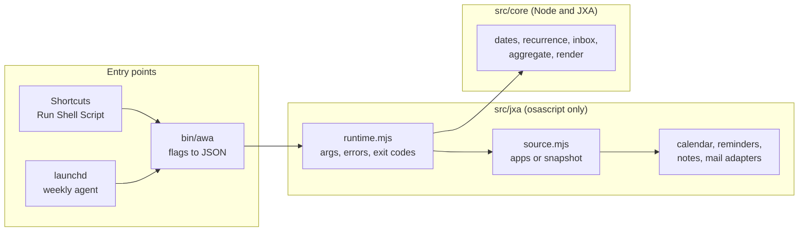

# Architecture

awa is a pure JavaScript core with thin JXA adapters around it. Everything that decides something lives in the core and runs under Node. Everything that talks to an app lives in the adapters and does as little as possible.

## Layers

| Layer | Path | Runs under | Knows about apps | Tested by |
| --- | --- | --- | --- | --- |
| Entry | `bin/awa` | bash 3.2 and later | No | `tests/awa-cli.test.mjs` |
| Runtime | `src/jxa/lib/runtime.mjs`, `source.mjs`, `io.mjs` | osascript | Through adapters only | `scripts/smoke-jxa.sh` |
| Adapters | `src/jxa/lib/{calendar,reminders,notes,mail}.mjs`, `apps.mjs` | osascript | Yes, and nothing else does | Manual, on a real Mac |
| Commands | `src/jxa/commands/*.mjs` | osascript | No, they call the source and the writer | `scripts/smoke-jxa.sh` |
| Core | `src/core/*.mjs` | Node and JavaScriptCore | No, ESLint forbids the JXA globals there | `tests/*.test.mjs` |

## The record shapes

Adapters and the `--input` snapshot both produce the same plain records, defined in `src/core/model.mjs`.

| Record | Fields |
| --- | --- |
| Event | `id`, `calendar`, `title`, `start`, `end`, `allDay`, `location`, `url`, `notes`, `recurrence`, `status`, `attendees[]` |
| Reminder | `id`, `list`, `title`, `due`, `completed`, `completedAt`, `priority`, `notes` |
| Note | `id`, `folder`, `title`, `modifiedAt`, `body` |
| Message | `subject`, `sender`, `receivedAt`, `mailbox` |

Because the core only ever sees these shapes, a snapshot file is enough to reproduce any output. That is how the tests, the README sample and the macOS smoke run work without touching an app.

## How a command runs

1. `bin/awa` turns flags into one JSON argument and calls `osascript -l JavaScript dist/<command>.js '<json>'`.
2. `runtime.mjs` parses the JSON (or raw `--flags`), validates it against the schema in `core/options.mjs`, and picks a source: the apps, or the snapshot given with `--input`.
3. The command reads records through the source, hands them to the core, and gets back a document plus stats.
4. The core renders the document to HTML for Notes or Markdown for the terminal.
5. Unless it is a dry run, the command writes through `writer()`, the only object that can change an app. In a dry run or a snapshot run every writer method throws.
6. Errors become `AwaError` with a code, a message and a hint. The runtime prints them to stderr and exits with the matching status.

## Exit codes

| Code | Meaning |
| --- | --- |
| 0 | Done |
| 1 | Unexpected error |
| 2 | Usage error (unknown option, bad value) |
| 3 | macOS refused access to an app (see [permissions](permissions.md)) |
| 4 | Something named does not exist (folder, note, list) |
| 5 | Bad input file |

## Building for JXA

JXA has no module loader. `scripts/build.mjs` reads each command, follows its imports, wraps every module in a function scope and concatenates them in dependency order into `dist/<command>.js`. See [ADR 0002](adr/0002-bundle-with-a-small-build-step.md).

## Calendar recurrence

Calendar's scripting dictionary returns a recurring series once, as its first occurrence. The adapter therefore asks for the events overlapping the range, and also for every series that started before the range ends. `core/recurrence.mjs` expands `DAILY`, `WEEKLY` (with `BYDAY`), `MONTHLY` and `YEARLY` rules with `INTERVAL`, `COUNT` and `UNTIL`. Other rules are reported in the review as not expanded. Exceptions to a series (a moved or deleted occurrence) are not visible through scripting and are not applied.
